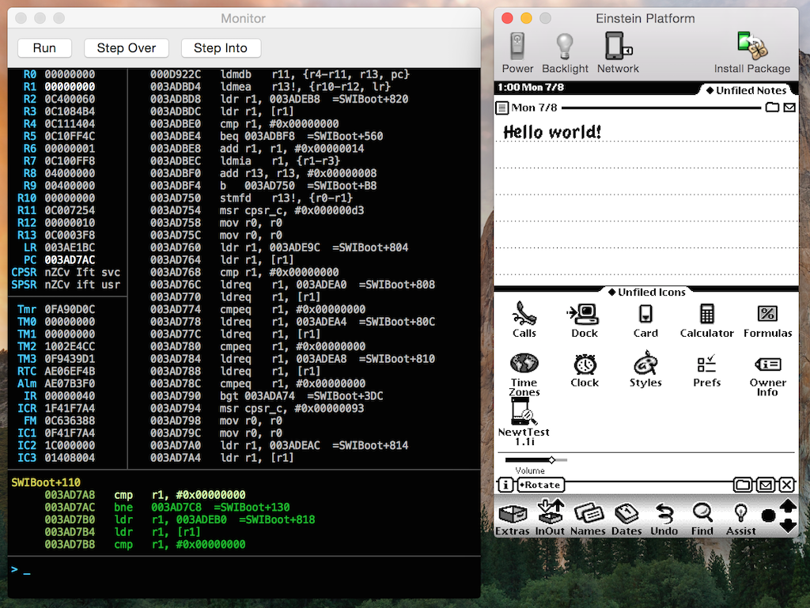

# Einstein is a NewtonOS emulator.

Einstein is supported in different tiers, using CMake as the main build tool,
and Xcode as additional tool available for macOS and iOS/iPadOS builds:

**Tier 1**: Built in the CI on each pull request, official releases

- macOS with FLTK and Cocoa UI
- Linux with FLTK UI
- Windows with FLTK UI, built with MinGW (cross compiled and native),
  MSVC only for release builds

**Tier 2**: CI builds available

- Linux with SDL3 UI
- Android with SDL3 UI

**Tier 3**: Experimental

- iOS and iPadOS
- OpenBSD/FreeBSD/NetBSD: Configurable via CMake, but not compiled or tested
- Windows with SDL3 UI
- macOS with SDL3 UI

See [target and feature support mechanisms](TARGETS.md) for more details.

A Newton ROM file is required to run Einstein. We cannot distribute the ROM
file. If you own a Newton device, you may be able to dump your own ROM file from
it. See [Dumping The Rom](../../wiki/Dumping-The-Rom) for more information.

Click here for [downloads and more information](../../wiki)

To get started, read the [user guide](Documentation/UserGuide.md).

